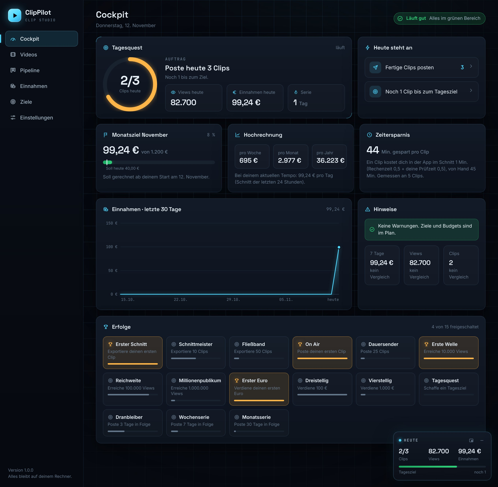
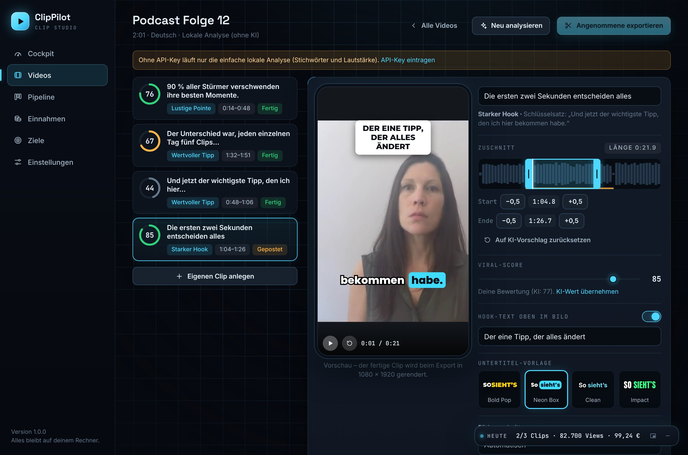

# ClipPilot

ClipPilot macht aus langen Videos (Streams, Podcasts, Interviews) fertige Hochkant-Clips für YouTube Shorts, TikTok und Instagram Reels – mit Untertiteln, Titel und Beschreibung. Die App läuft auf deinem eigenen Rechner und bleibt neben der Arbeit im Browser offen.

## Starten

Du brauchst einmal **Python 3.13** (3.10 bis 3.14 gehen auch). Alles andere richtet ClipPilot beim ersten Start selbst ein.
**Python 3.15 oder neuer funktioniert noch nicht**, weil es einige Bausteine dafür noch nicht gibt. Du kannst 3.13 einfach zusätzlich installieren.

### Mac

1. Python 3.13 installieren: [python.org/downloads/macos](https://www.python.org/downloads/macos/) → „Python 3.13.x“ → „macOS 64-bit universal2 installer“.
2. Im ClipPilot-Ordner `ClipPilot starten.command` doppelklicken.
3. Meldet der Mac „kann nicht geöffnet werden“ oder „Apple konnte nicht überprüfen …“: **Systemeinstellungen → Datenschutz & Sicherheit** öffnen, ganz nach unten scrollen und bei ClipPilot auf **„Trotzdem öffnen“** klicken. Danach noch einmal doppelklicken. Das ist nur beim ersten Mal nötig.

Klappt der Doppelklick gar nicht, geht es immer über das Terminal: Programm **Terminal** öffnen, `bash ` eintippen (mit Leerzeichen), die Datei `start.sh` aus dem ClipPilot-Ordner ins Terminal-Fenster ziehen und Enter drücken.

### Windows

`ClipPilot starten.bat` doppelklicken. Fehlt Python, installiert die Datei es automatisch – danach noch einmal doppelklicken.

### Linux

Im Ordner `./start.sh` ausführen.

### Alternativ: mit Python öffnen

`ClipPilot starten.py` lässt sich auch direkt mit Python öffnen (Rechtsklick → „Öffnen mit“ → „Python Launcher“). Bitte **nicht** die Dateien im Ordner `clippilot` mit Python öffnen – die startet ClipPilot selbst.

Der erste Start dauert ein paar Minuten (Bausteine werden geladen, rund 1 GB). Danach öffnet sich ClipPilot im Browser unter `http://127.0.0.1:8756`. Das Terminal-Fenster bleibt offen, solange du arbeitest. Zum Beenden schließt du es.

Am besten nutzt du **Chrome oder Edge**: Nur dort lässt sich das Mini-Fenster so ablösen, dass es über anderen Programmen sichtbar bleibt.

## Der Ablauf in sechs Schritten

1. **Videos → Video hineinziehen** (oder einen Link einfügen, wenn du die Rechte bzw. eine Kampagnenfreigabe hast). ClipPilot transkribiert das Video und sucht die besten Momente.
2. **Prüfen:** Jeder Vorschlag hat einen Viral-Score, eine Begründung und einen Hook-Text. Du siehst die Vorschau, schiebst Start und Ende zurecht und klickst **Annehmen** oder **Verwerfen**. Den Score kannst du jederzeit selbst überschreiben.
3. **Exportieren:** ClipPilot schneidet auf 9:16 (1080 × 1920), hält das Gesicht in der Mitte, brennt die Untertitel Wort für Wort ein und blendet den Hook oben ein. Titel, Beschreibung und Hashtags je Plattform entstehen gleich mit.
4. **Pipeline:** Karten von „Kandidaten“ bis „Gepostet“ ziehen. Auf „Fertig“ ziehen startet den Export.
5. **Einnahmen:** Kampagne anlegen (Bezahlung pro 1.000 Views, Budget, Regeln), bei geposteten Clips Link und Views eintragen. ClipPilot rechnet die Einnahmen pro Clip, Kampagne, Tag und Monat aus.
6. **Cockpit und Ziele:** Tagesquest, Serie, Monatsziel, Hochrechnung und Zeitersparnis auf einen Blick. Unten rechts sitzt das Mini-Fenster mit den Zahlen von heute.

## KI einrichten (optional, empfohlen)

Die Transkription läuft immer lokal und kostet nichts. Für **Highlights und Texte** gibt es zwei Stufen:

- **Mit Anthropic-API-Key (Claude):** Die KI liest das Transkript und wählt die Stellen aus. So bekommst du den Key: auf [console.anthropic.com](https://console.anthropic.com) anmelden, unter „API Keys“ einen Key erstellen (beginnt mit `sk-ant-`), Guthaben aufladen. In ClipPilot unter **Einstellungen → KI** einfügen und auf „Testen“ klicken. Pro Analyse fallen bei Anthropic Kosten an.
- **Ohne Key:** Eine einfache lokale Analyse aus Stichwörtern, Satzbau und Lautstärke. Sie ist deutlich schwächer und in der App immer als „Lokale Analyse (ohne KI)“ gekennzeichnet.

Der Key wird nur in `data/config.json` auf deinem Rechner gespeichert, nie im Programmcode. Mit Key wird das Transkript (nicht das Video) zur Auswertung an Anthropic geschickt.

## Wo liegen meine Daten?

Alles liegt im Ordner `data` neben der Start-Datei: Videos, exportierte Clips (`data/projects/<Nummer>/exports`), Datenbank und Einstellungen. Der Ordner wird nicht ins Repo hochgeladen. Für ein Backup kopierst du ihn einfach.

**Beispieldaten** lädst du unter Einstellungen → Daten. Sie sind überall als „Beispiel“ markiert, oben erscheint ein Hinweis, und ein Klick auf „Beispieldaten löschen“ entfernt sie wieder.

## Gut zu wissen

- **Geschwindigkeit:** Ohne Grafikkarte braucht die Transkription mit dem Modell „Small“ grob ein Viertel der Videolänge. Ein dreistündiger Stream dauert also eine Weile. Mit Nvidia-Grafikkarte geht es deutlich schneller, und du kannst in den Einstellungen ein größeres Modell wählen.
- **Einnahmen pro Tag:** Du trägst die aktuelle Gesamtzahl der Views ein. Der Zuwachs zählt für den Tag, an dem du ihn einträgst. Ist das Budget einer Kampagne aufgebraucht, zählt ClipPilot dort nichts mehr dazu.
- **Views** trägst du im Moment von Hand ein. Schnittstellen zu den Plattformen gibt es noch nicht.
- **Zeitersparnis:** Vergleich aus deiner Angabe („so lange brauche ich von Hand“) und gemessener Zeit in der App (Rechenzeit plus deine Zeit auf der Prüf-Seite).
- **Rechte:** Lade und clippe nur Material, das du verwenden darfst.

## Wenn etwas nicht klappt

- **Die Seite lädt nicht:** Läuft das Start-Fenster noch? Sonst Start-Datei erneut doppelklicken.
- **„Sprachmodell konnte nicht geladen werden“:** Beim ersten Mal wird es aus dem Internet geladen. Verbindung prüfen und im Projekt auf „Erneut versuchen“ klicken.
- **„Dieses Python hat die Version 3.15“ / „zu neu“:** Python 3.13 zusätzlich installieren (siehe oben) und neu starten. ClipPilot nimmt dann automatisch die passende Version.
- **Mac: „kann nicht geöffnet werden“:** Systemeinstellungen → Datenschutz & Sicherheit → „Trotzdem öffnen“.
- **Ein Link lässt sich nicht laden:** Video herunterladen und per Drag & Drop importieren.
- **Alles zurücksetzen:** ClipPilot beenden und den Ordner `data` löschen (vorher sichern, falls du die Clips noch brauchst).

## Stand der Tests

Getestet auf Linux mit zwei kurzen Testvideos (Deutsch und Englisch): Upload, Link-Import, Transkription, Vorschläge, Zuschnitt, Export, Texte, Pipeline, Einnahmen, Ziele, Beispieldaten und Mini-Fenster. **Noch nicht getestet:** die Start-Dateien auf echten Windows- und Mac-Rechnern (geprüft nur unter Linux, inklusive falscher Python-Versionen), die Auswertung mit einem echten Anthropic-Key (nur gegen eine nachgebaute Schnittstelle), Videos mit mehreren Stunden Länge und Links zu YouTube oder Twitch.

## Für Neugierige

Python-Backend (FastAPI, SQLite), faster-whisper für die Transkription, OpenCV (YuNet) für die Gesichtserkennung, ffmpeg für den Schnitt, Oberfläche ohne Build-Schritt in `clippilot/web`. Das frühere Dashboard und das alte Schnitt-Skript liegen in `archiv/`. Schriften und Gesichtsmodell: Lizenzen in `clippilot/assets/fonts/LIZENZ.txt`.
